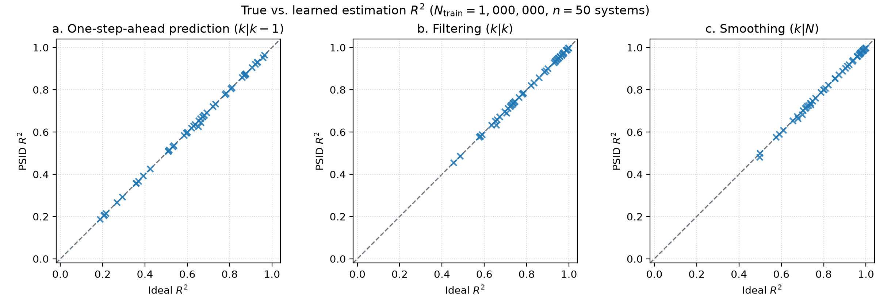
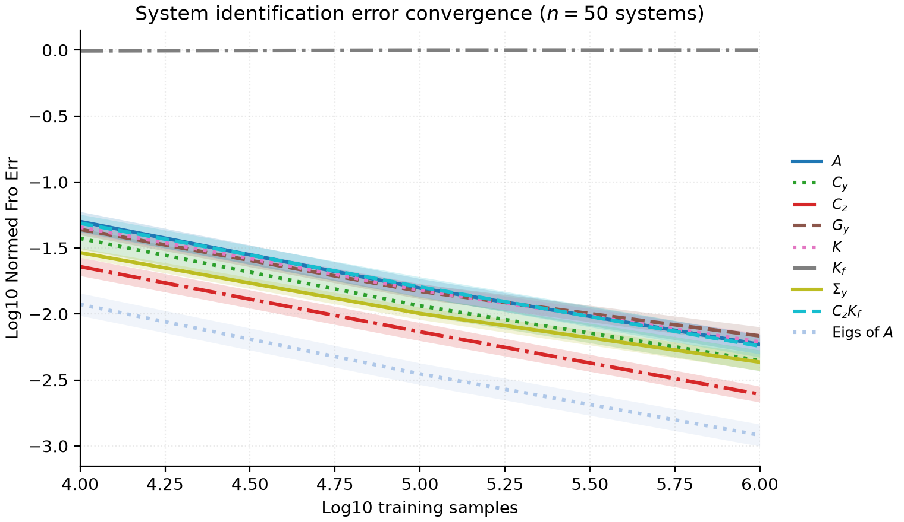

# Paper Simulation & Key-Result Reproduction

This directory contains standalone scripts to reproduce the key PSID simulation results from the NeurIPS 2026 PSID/DPAD smoothing paper ([OpenReview PDF](https://openreview.net/pdf?id=vFZhylvjKq)) without bundling paper-specific scripts or output artifacts into the `PSID` PyPI package (`source/PSID/`).

## Quick check (~10–20 seconds)

Runs 10 random linear systems across $N_{\text{train}} \in \{10^4, 10^5\}$:

```bash
python paper/reproduce_psid_smoothing_paper.py
```

## Full paper scale (50 systems, $N_{\text{train}} \in \{10^4, 10^5, 10^6\}$)

```bash
python paper/reproduce_psid_smoothing_paper.py --n-systems 50 --n-train-log10 4 5 6 --n-test 1000000
```

### Runtime breakdown

A single `PSIDModel.fit` call is fast even at $N_{\text{train}} = 10^6$ (~8.5s without smoothing, ~24s with smoothing on a representative system with $n_x=7, n_1=4, n_y=9, n_z=7, i=5$). The full 50-system benchmark takes ~3–6 hours without parallelization only because each system repeats:
- **5 model variants** (main model + 4 ablations) across **3 training sizes** ($10^4, 10^5, 10^6$) = **15 model fits per system** (750 fits total)
- **10 decoding evaluations** on **$10^6$ test samples** per training size = **30 test-set passes per system** (1,500 evaluations total), plus parameter-error calculations

Measured single-model timings on `system_01`:

| $N_{\text{train}}$ | `fit` (no smoothing) | `fit` (with smoothing) | `predict` ($10^6$ test) | `smoothing` ($10^6$ test) |
| ---: | ---: | ---: | ---: | ---: |
| 10,000 | 0.09s | 0.24s | 4.07s | 7.82s |
| 100,000 | 1.48s | 3.66s | 3.98s | 8.25s |
| 1,000,000 | 8.53s | 24.33s | 3.88s | 7.83s |

Loading a cached 2M-sample Parquet realization takes ~0.2s; loading completed `cache/<sys_code>/*.json` metrics takes <1s total.

Outputs are written to `paper/results/` (gitignored):
- `realizations/<sys_code>/`: saved random `LSSM` models (`system_<idx>_seed<seed>.pkl`) and zstd-compressed Parquet time series (`system_<idx>_seed<seed>_data.parquet`, reused on subsequent runs)
- `cache/<sys_code>/`: per-system cached evaluation JSONs so runs can be extended (e.g., from 20 to 50 systems) without recomputing earlier systems
- `summary_metrics.json`: per-system and aggregated parameter errors and decoding $R^2$
- `summary_tables.md`: Markdown summary of parameter identification errors and decoding $R^2$
- `fig2_decoding_scatter.png` / `.pdf`: 3-panel Ideal vs. PSID decoding $R^2$ scatter plots for prediction ($k|k-1$), filtering ($k|k$), and `bwYRes` smoothing ($k|N$)
- `fig5_param_convergence.png` / `.pdf`: parameter identification error convergence across $N_{\text{train}}$

## Reproduced Results (50 systems)

The figures and tables in [`figures/`](figures/) are a fresh reproduction of the key PSID simulation results from the NeurIPS 2026 PSID/DPAD smoothing paper generated using the script provided in `paper/` (`python paper/reproduce_psid_smoothing_paper.py --n-systems 50 --n-train-log10 4 5 6 --n-test 1000000`, `seed=42`). Full tables are in [`figures/summary_tables.md`](figures/summary_tables.md).

### Behavioral Decoding $R^2$ (Fig. 2 & Table 4, $N_{\text{train}} = 10^6$, mean ± SEM)



| Setting | Model | Mean decoding $R^2$ | SEM |
| --- | --- | ---: | ---: |
| *One-step-ahead prediction* | Standard PSID, used as a Kalman predictor | 0.6315 | 0.0313 |
|  | Ideal prediction (true model parameters) | 0.6325 | 0.0313 |
| *Filtering* | Standard PSID's parameters, used in a Kalman filter | 0.6315 | 0.0313 |
|  | Prediction with time-shifted data | 0.7393 | 0.0258 |
|  | **PSID with filtering (ours)** | 0.8071 | 0.0215 |
|  | Ideal filtering (true model parameters) | 0.8080 | 0.0214 |
| *Smoothing* | Standard PSID's parameters, used in a Kalman smoother | 0.6315 | 0.0313 |
|  | PSID with smoothing, backward pass on $z$ itself (non-residual) | 0.8062 | 0.0233 |
|  | **PSID with smoothing (ours, residual backward pass)** | 0.8287 | 0.0206 |
|  | Ideal smoothing (true model parameters) | 0.8300 | 0.0204 |

### Parameter Identification Error Convergence (Fig. 5)



## IPSID causal filtering validation ($n_u > 0$, standalone check)

Separately from the smoothing paper, `validate_ipsid_filtering.py` reuses the simulation and caching utilities above to verify that `PSIDModel` causal filtering ($k|k$) with external inputs ($n_u > 0$) reaches oracle filtering performance:

```bash
python paper/validate_ipsid_filtering.py --n-systems 20 --n-train-log10 4 5 6 --n-test 1000000
```
